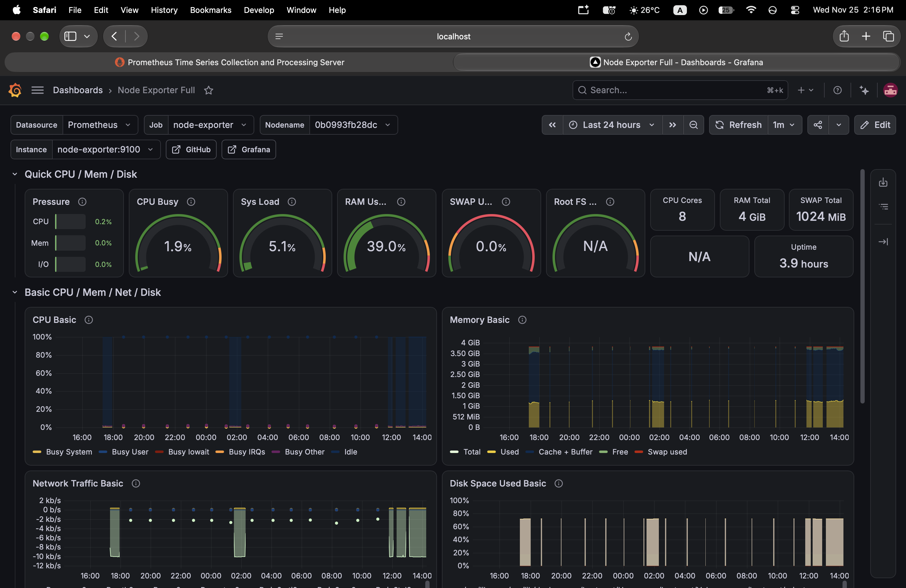
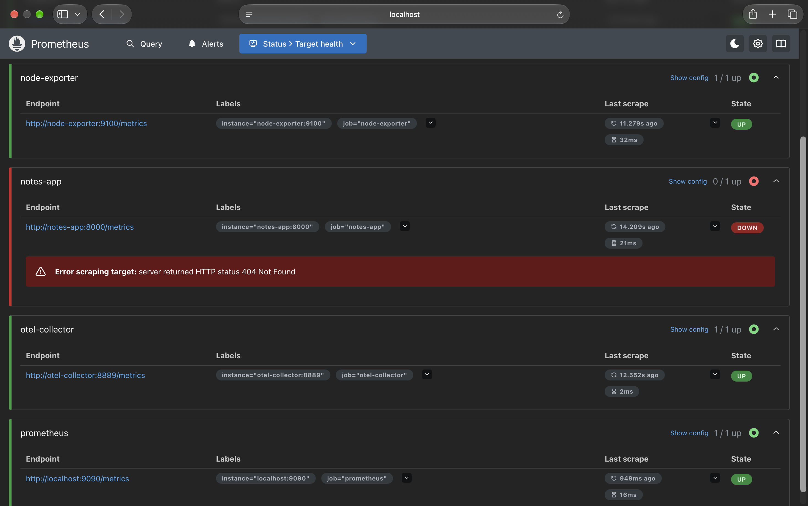
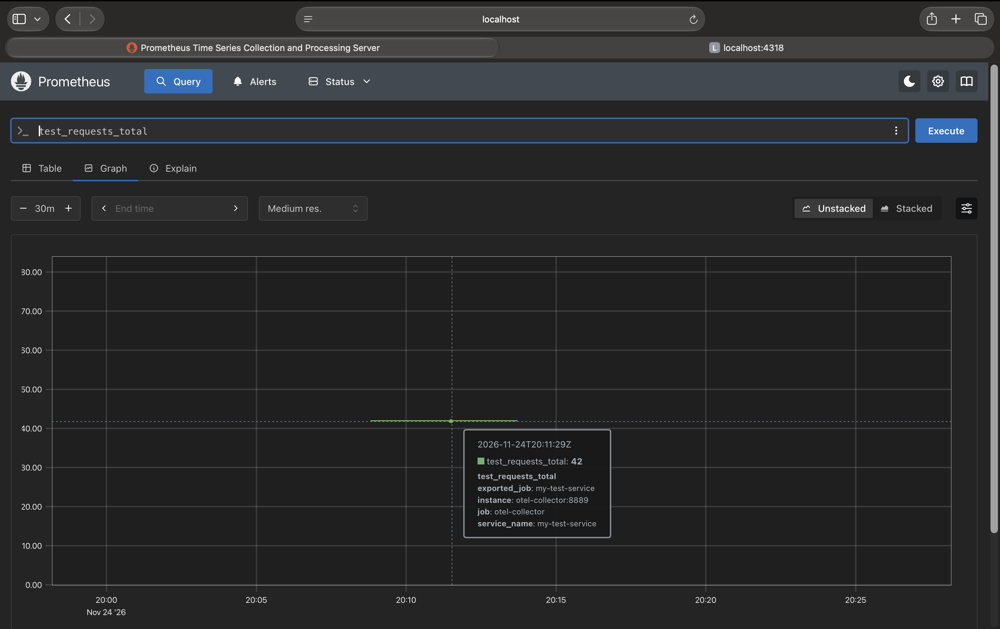
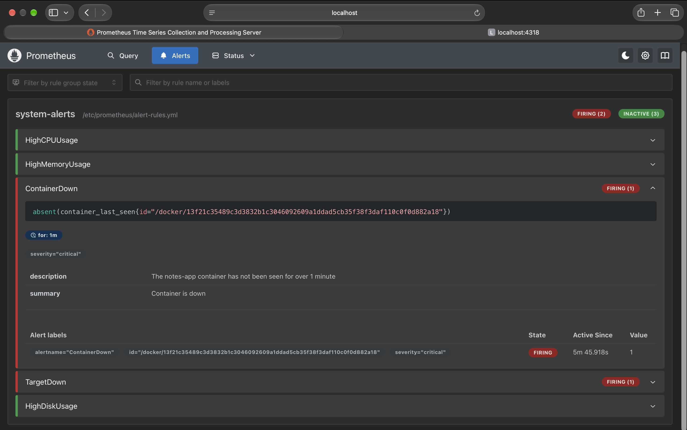
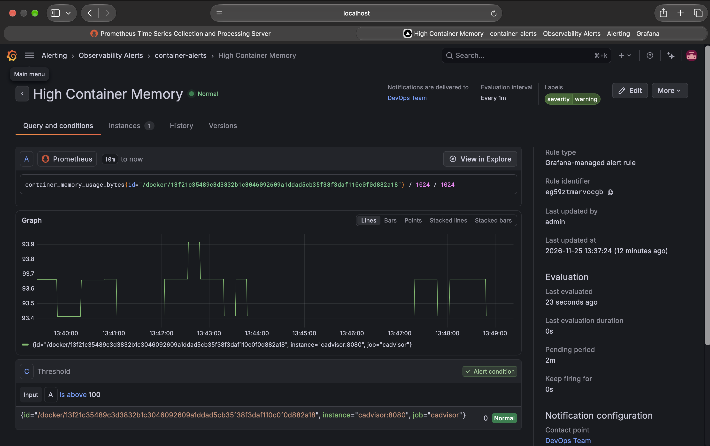

# Full-Stack Observability Platform (Metrics, Logs, Traces & Alerting)

A self-hosted, 8-container local observability stack built with Docker Compose covering all three pillars of observability (**Metrics, Logs, and Traces**) along with proactive alerting across **Prometheus** and **Grafana Unified Alerting**.

Designed and tested end-to-end on macOS (Apple Silicon / Docker Desktop) with production-style practices including OTEL memory limiting, config validation (`otelcol-contrib validate`, `promtool`), zero-downtime Prometheus config reloads, and controlled outage testing.

---

<p align="center">
  
</p>

## Architecture Overview

```text
====================================================================================================
                                    1. METRICS PIPELINE (PULL & PUSH)
====================================================================================================
[Node Exporter :9100] ----------------\
[cAdvisor :8080] ----------------------\
                                        +---> [Prometheus :9090] ---> [Grafana Dashboards :3000]
[App / curl] --(OTLP)--> [OTEL Collector]     (Scrapes every 15s)     [Prometheus Alert Rules]
                         (:4317/:4318 -> :8889)                         (Inactive -> Pending -> Firing)

====================================================================================================
                                       2. LOGS PIPELINE (PUSH)
====================================================================================================
[All 8 Docker Containers] ---> [Promtail :9080] ---> [Loki :3100] ---> [Grafana Explore & Panels]
(stdout / stderr streams)      (docker_sd_configs)   (TSDB + Chunks)    (LogQL + Time Sync)

====================================================================================================
                                      3. TRACES PIPELINE (OTLP)
====================================================================================================
[App / curl] --(OTLP gRPC/HTTP)--> [OTEL Collector (:4317 / :4318)]
                                          |
                                          +---> [memory_limiter -> batch]
                                          |
                                          +---> [Debug Exporter (stdout)]  (Local Verification)
                                          +---> [Swappable: Grafana Tempo / Jaeger in Production]

====================================================================================================
                                  4. UNIFIED ALERTING & ROUTING
====================================================================================================
[Prometheus Metrics / Loki Logs] ---> [Grafana Alert Rules (1m eval, 2m pending)]
                                                |
                                                v
                                      [Notification Policies]
                                       ├── severity=critical ---> Fast Route (DevOps Team)
                                       └── Default Policy ------> Standard Route (DevOps Team)
```

---

## Repository Structure & File Breakdown

```text
observability-stack/
├── docker-compose.yml                  # Orchestrates all 8 services, ports, volumes & restart policies
├── prometheus.yml                      # Prometheus scrape configs (15s interval) & alert rule loading
├── alert-rules.yml                     # 5 Prometheus alerting rules (CPU, RAM, Disk, Container & Target health)
├── otel-collector/
│   └── otel-collector-config.yml       # OTEL Collector pipeline (OTLP receivers, memory_limiter, batch, exporters)
├── loki/
│   └── loki-config.yml                 # Grafana Loki log storage & TSDB indexing configuration
├── promtail/
│   └── promtail-config.yml             # Promtail Docker service discovery & log shipping config
├── grafana/
│   └── provisioning/                   # Auto-provisioned Grafana datasources & dashboard configurations
├── screenshots/                        # Live verification proofs (Prometheus targets, OTLP metrics, alerts)
└── README.md                           # Project documentation, setup guide & troubleshooting notes
```

### What Each File & Folder Does

| Path | Responsibility |
| :--- | :--- |
| **`docker-compose.yml`** | Defines all 8 containers (`prometheus`, `node-exporter`, `cadvisor`, `grafana`, `loki`, `promtail`, `otel-collector`, `notes-app`), persistent Docker volumes (`prometheus_data`, `grafana_data`, `loki_data`), read-only config mounts, and `--web.enable-lifecycle` for hot-reloading Prometheus. |
| **`prometheus.yml`** | Configures global `15s` scrape/evaluation intervals, loads `/etc/prometheus/alert-rules.yml`, and scrapes 4 metric targets: `prometheus:9090`, `node-exporter:9100`, `cadvisor:8080`, and `otel-collector:8889`. |
| **`alert-rules.yml`** | Defines the `system-alerts` rule group with 5 production-style alerts (`HighCPUUsage`, `HighMemoryUsage`, `ContainerDown`, `TargetDown`, `HighDiskUsage`) using PromQL expressions, `for` pending buffers, severity labels, and Go-template annotations. |
| **`otel-collector/otel-collector-config.yml`** | Configures `otel/opentelemetry-collector-contrib` (`v0.165.0`) with OTLP gRPC (`4317`) and HTTP (`4318`) receivers, `memory_limiter` (400 MiB cap) placed ahead of `batch` to prevent OOM kills, a `health_check` extension (`13133`), `debug` exporter for traces/logs, and a Prometheus exporter (`8889`) with `resource_to_telemetry_conversion` enabled. |
| **`loki/loki-config.yml`** | Configures Loki as the label-indexed log aggregation backend storing chunks and TSDB indexes on persistent storage. |
| **`promtail/promtail-config.yml`** | Connects to `/var/run/docker.sock` and `/var/lib/docker/containers` to automatically discover running Docker containers and ship their `stdout`/`stderr` logs to Loki. |
| **`grafana/provisioning/`** | Mounted into `/etc/grafana/provisioning` so Grafana automatically loads configured datasources (Prometheus and Loki) on startup without manual UI setup. |

---

## Services & Ports

| Service | Image | Port(s) | Role |
| :--- | :--- | :--- | :--- |
| **Prometheus** | `prom/prometheus:latest` | `9090` | Time-series metrics database, PromQL engine & alert evaluator |
| **Node Exporter** | `prom/node-exporter:latest` | `9100` | Host/VM CPU, memory, filesystem & network metrics |
| **cAdvisor** | `gcr.io/cadvisor/cadvisor:latest` | `8080` | Per-container CPU, memory & lifecycle metrics |
| **Grafana** | `grafana/grafana-enterprise:latest` | `3000` | Unified dashboards (`v13.3.1`), LogQL/PromQL correlation & Unified Alerting |
| **Loki** | `grafana/loki:latest` | `3100` | Label-indexed log aggregation backend |
| **Promtail** | `grafana/promtail:latest` | `9080` | Container log collector & shipper |
| **OTEL Collector** | `otel/opentelemetry-collector-contrib:latest` | `4317`, `4318`, `8889`, `13133` | OTLP gRPC/HTTP receiver, Prometheus metric bridge & health probe |
| **Notes App** | `trainwithshubham/notes-app:latest` | `8000` | Target web application generating live traffic and logs |

---

## Quick Start

### 1. Clone & Start the Stack
```bash
git clone [https://github.com/rashid-khan681/observability-stack.git](https://github.com/rashid-khan681/observability-stack.git)
cd observability-stack
docker compose up -d
```

> **Note for `ContainerDown` Alert:** In `alert-rules.yml`, `ContainerDown` uses cAdvisor's `/docker/<container-id>` selector for macOS Docker Desktop compatibility. After starting the stack on a new machine, update the container ID using:
> ```bash
> docker inspect --format='{{.Id}}' notes-app
> ```
> *(On native Linux hosts, `container_last_seen{name="notes-app"}` can be used directly.)*

### 2. Access the UIs
* **Grafana:** `http://localhost:3000` (`admin` / `admin123`)
* **Prometheus:** `http://localhost:9090`
* **Notes App:** `http://localhost:8000`
* **cAdvisor:** `http://localhost:8080`

### 3. Verify All Services & Health Endpoints
```bash
docker compose ps
echo "Prometheus:  $(curl -s http://localhost:9090/-/ready)"
echo "Loki:        $(curl -s http://localhost:3100/ready)"
echo "Grafana:     $(curl -s http://localhost:3000/api/health | tr -d '\n')"
echo "OTEL Health: $(curl -s http://localhost:13133)"
echo "Notes App:   HTTP $(curl -s -o /dev/null -w '%{http_code}' http://localhost:8000)"
```

---

## Config Validation & Testing

### Validate Configs Before Reloading (CI/CD Best Practice)
```bash
# Validate Prometheus alert rules syntax
docker run --rm --entrypoint promtool \
  -v "$(pwd)/alert-rules.yml:/etc/prometheus/alert-rules.yml:ro" \
  prom/prometheus:latest check rules /etc/prometheus/alert-rules.yml

# Validate OpenTelemetry Collector pipeline configuration
docker compose run --rm otel-collector validate --config=/etc/otelcol-contrib/config.yaml

# Zero-downtime Prometheus config reload
curl -X POST http://localhost:9090/-/reload
```

### Send a Test OTLP Trace & Metric
```bash
START_NS="$(date +%s)000000000"
END_NS="$(( $(date +%s) + 1 ))000000000"

# Push OTLP trace to port 4318
curl -i -X POST http://localhost:4318/v1/traces \
  -H "Content-Type: application/json" \
  -d "{\"resourceSpans\":[{\"resource\":{\"attributes\":[{\"key\":\"service.name\",\"value\":{\"stringValue\":\"my-test-service\"}}]},\"scopeSpans\":[{\"spans\":[{\"traceId\":\"5b8efff798038103d269b633813fc60c\",\"spanId\":\"eee19b7ec3c1b174\",\"name\":\"test-span\",\"kind\":1,\"startTimeUnixNano\":\"${START_NS}\",\"endTimeUnixNano\":\"${END_NS}\",\"attributes\":[{\"key\":\"http.method\",\"value\":{\"stringValue\":\"GET\"}},{\"key\":\"http.status_code\",\"value\":{\"intValue\":\"200\"}}]}]}]}]}"

# Verify parsed span in Collector logs
docker logs otel-collector 2>&1 | grep -B 5 -A 15 "test-span"

# Push OTLP counter metric and verify on Prometheus exporter (:8889)
curl -i -X POST http://localhost:4318/v1/metrics \
  -H "Content-Type: application/json" \
  -d "{\"resourceMetrics\":[{\"resource\":{\"attributes\":[{\"key\":\"service.name\",\"value\":{\"stringValue\":\"my-test-service\"}}]},\"scopeMetrics\":[{\"metrics\":[{\"name\":\"test_requests_total\",\"sum\":{\"dataPoints\":[{\"asInt\":\"42\",\"startTimeUnixNano\":\"${START_NS}\",\"timeUnixNano\":\"${END_NS}\"}],\"aggregationTemporality\":2,\"isMonotonic\":true}}]}]}]}"

curl -s http://localhost:8889/metrics | grep "test_requests"
```

### Controlled Outage Alert Test
```bash
# Trigger ContainerDown and TargetDown alerts
docker compose stop notes-app node-exporter

# Wait ~75s (for: 1m pending period), then inspect firing alerts
curl -s http://localhost:9090/api/v1/alerts

# Restore services
docker compose start notes-app node-exporter
```

---

## Alerting Architecture

1. **Prometheus Rules (`alert-rules.yml`)**: Evaluates 5 infrastructure/container alerts every `15s` with `for` pending buffers (`1m`–`5m`) to prevent alert flapping.
2. **Grafana Unified Alerting (`v13.3.1`)**:
   * **Contact Point:** `DevOps Team` (Email integration).
   * **Alert Rule:** `High Container Memory` monitoring `notes-app` RAM (`> 100 MB`, `1m` evaluation, `2m` pending, `severity=warning`).
   * **Notification Policies:** Default policy routed to `DevOps Team` with a nested route matching `severity=critical` configured for faster dispatch (`10s` group wait, `1h` repeat interval).

---

## Key Engineering Decisions & Troubleshooting

* **Preventing OTEL Collector OOM Crashes:** Ordered `processors: [memory_limiter, batch]` per OpenTelemetry production guidelines so incoming burst traffic is throttled before batch buffering consumes container RAM.
* **Preserving Service Metadata Across OTLP -> Prometheus:** Enabled `resource_to_telemetry_conversion` on the OTEL Prometheus exporter so `service.name` propagates directly as a PromQL label (`service_name="my-test-service"`).
* **Eliminating False-Positive `TargetDown` Noise:** `notes-app:8000` is a Django web app without a `/metrics` endpoint (returning HTTP `404`), which caused false `up == 0` alerts when scraped directly. Removed it from `prometheus.yml` scrape targets while monitoring its uptime via cAdvisor's `absent(container_last_seen{...})` rule and its logs via Promtail/Loki.
* **macOS Docker Desktop Compatibility:** Adapted cAdvisor and Node Exporter queries to use `id="/docker/<id>"` and `mountpoint="/var/lib/docker"` instead of Linux-only defaults so both Prometheus and Grafana alert rules evaluate live telemetry rather than returning `NoData`.

---

## Screenshots

| Verification | Preview |
| :--- | :--- |
| **OTEL Collector Target UP in Prometheus** |  |
| **OTLP Metric (`test_requests_total`) in Prometheus** |  |
| **Prometheus Alert Rules (`Firing` & `Inactive`)** |  |
| **Grafana Unified Alert Rule** |  |